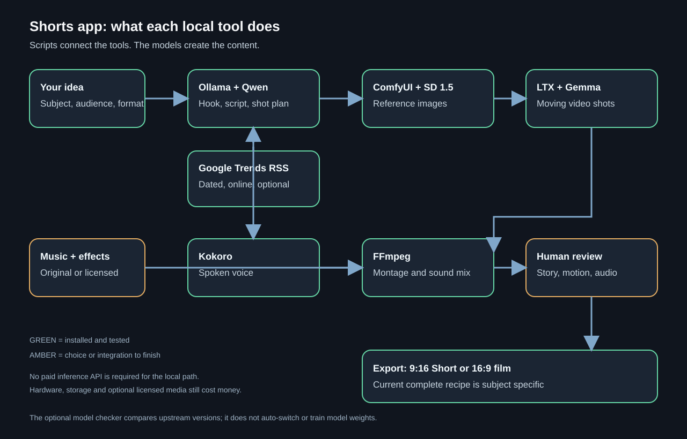
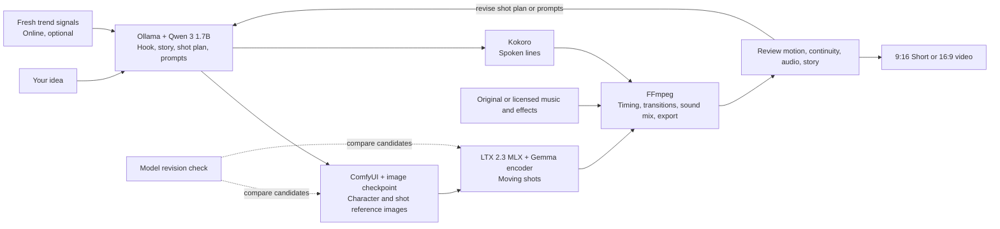

# How the local Shorts stack fits together





Python and Node scripts are orchestration: they send prompts to Ollama or ComfyUI, launch LTX and Kokoro, pass files between tools, and invoke FFmpeg. They do not replace those models or render images by themselves.

| Tool | What it contributes | Current state on this Mac |
| --- | --- | --- |
| Ollama + Qwen 3 1.7B | Local idea, hook, script, and structured scenario drafting | Installed; `npm run draft:local` |
| ComfyUI + Stable Diffusion 1.5 | Local still image generation and reference-guided variations | Installed; `npm run image:local:mac` |
| LTX 2.3 MLX + Gemma | Local text/image-to-video shots; Gemma encodes the prompt for LTX | Installed and tested for moving shots |
| Kokoro | Local narration | Installed |
| FFmpeg | Assemble, resize, trim, mix, and export | Installed |

## What is automated today

Local scenario drafting, standalone image generation, local motion generation, local narration, and montage have each been exercised. The proven complete chocolate Short has a subject-specific recipe. A general single-command idea-to-finished-video pipeline for any story, with reusable characters, all sound, automatic quality review, and both aspect ratios is still being integrated and tested. A new story currently needs its shot plan and final assembly reviewed.

The cat storyboard reference images in the current demonstration were created with Codex image generation. The standalone `image:local:mac` command does run the installed ComfyUI checkpoint entirely on the Mac; its current SD 1.5 output has lower quality and weaker character consistency than those references. The optional SDXL checkpoint was not installed because its large download timed out. It is not part of the working path.

## Trends, models, and cost

Qwen has no live view of trends or current model releases by itself. Fresh trend claims require a dated online source and a region or audience. The verified Google Trends RSS fetch provides a selectable search-trend signal; it does not automatically choose a topic. YouTube's mostPopular chart is another possible source but is not integrated. Review relevance and source dates before choosing a concept.

The app can now fetch a dated Google Trends RSS snapshot. Choose the target audience's region explicitly:

```sh
npm run trends:local -- --region US --output drafts/generated/us-trends.json
```

Choose a relevant title from that snapshot, then let Qwen use it as dated context:

```sh
npm run draft:local -- "story topic" story-id --channel channels/bb.json --format short --seconds 30 --trend-file drafts/generated/us-trends.json --trend-title "exact selected trend title"
```

Google Trends measures search surges, not guaranteed Shorts performance. The feed is online and may change or be unavailable. Qwen still runs locally. Use original or licensed music; a trending song is not automatically reusable.

`npm run models:check:mac` checks installed revisions against upstream. A newer model should be downloaded as a separate candidate and compared on the same test scene before switching the active model. This check does not automatically install or train anything. Saving good prompts and feedback improves the workflow; changing model weights requires a separate fine-tuning project.

The local generation path needs no paid inference API. Hardware, electricity, disk space, downloads, and any optional licensed media still have costs. Trending music is not automatically free to reuse; choose original or properly licensed audio for an export.
